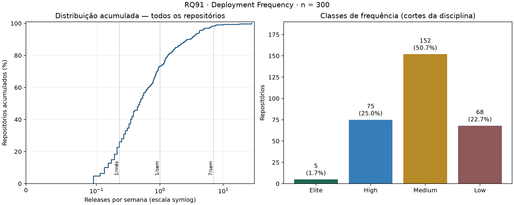
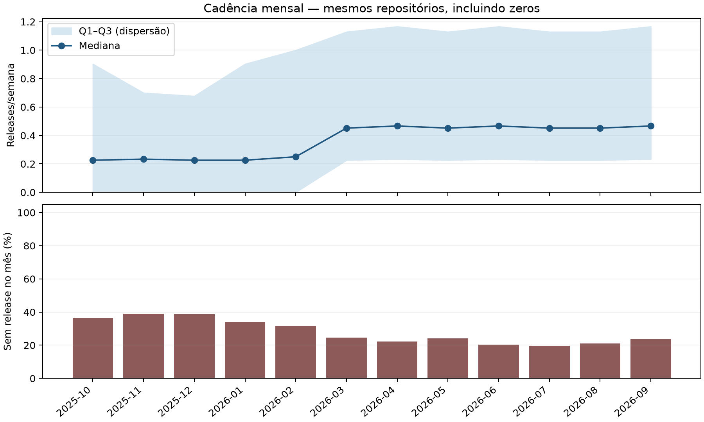

# RQ91 — RQ01: Deployment Frequency e classificação DORA

## Método e rastreabilidade

Janela inclusiva UTC: 2025-10-01 a 2026-09-30 (52.142857 semanas). **Provisória: janela ainda não confirmada pelo professor na configuração.**

Cada repositório tem o mesmo peso. Frequência = releases publicadas, não draft e não prerelease na janela / semanas da janela. Tags sem release ficam de fora. Os filtros usam published_at; não o texto da tag nem a marca dentro_janela. Contagens, frequências e classes foram reconciliadas com metricas_repositorios.csv. A classificação usa precisão completa antes do arredondamento. As faixas são as fixadas pela disciplina, reutilizando metricas/dora.py; um mês médio corresponde a 365,25/12 dias.

## Resultados

- Repositórios: **300**; releases principais: **18206**.
- Mediana: **0.4795 releases/semana**.
- Q1–Q3: **0.2301–1.1555**; IQR (Q3 − Q1): **0.9253**.
- Mínimo–máximo: **0.0959–28.1726**; P90: **2.7060**.
- Quartis calculados por interpolação linear; valores extremos mantidos.

| Classe de frequência | Repositórios | Percentual |
|---|---:|---:|
| Elite | 5 | 1.67% |
| High | 75 | 25.00% |
| Medium | 152 | 50.67% |
| Low | 68 | 22.67% |

Elite ≥ 7/semana; High ≥ 1 e < 7/semana; Medium ≥ 1/mês médio e < 1/semana; Low < 1/mês médio. **Esta é a classe de frequência, não a classificação geral das quatro métricas.**

## Discussão da H1 e limites

A H1 registrada em entregas/laboratorio-03/artigo/introducao.tex previa mediana entre 0,5 e 1 release/semana, concentração Medium/High e poucos Elite. A mediana observada está fora de essa faixa. Medium e High somam 75.67% e Elite representa 1.67%. A distribuição acumulada e o contraste entre Q3 e máximo permitem avaliar a cauda à direita sem excluir extremos. A hipótese original foi preservada. Esta comparação é descritiva, sem teste de hipótese ou alegação causal.

Não foi atribuído um novo limite numérico a “poucos Elite” ou “concentração” depois de observar os resultados. A compatibilidade dessas partes da H1 é qualitativa; a comparação da mediana usa a faixa originalmente registrada. IQR descreve dispersão, não intervalo de confiança. Não estimamos um intervalo populacional com base nesta seleção não probabilística.

## Concentração e extremos

Os 30 repositórios de maior contagem (10% da amostra, arredondado para cima) concentram **51.53% das releases**. Empates no corte são desfeitos pelo nome. Isso distingue a parcela de projetos em cada classe da parcela de releases produzida por eles.

Há **33 extremos superiores**, acima de Q3 + 1,5 × IQR = **2.5435 releases/semana**. Esse sinalizador descritivo não prova erro ou automação; nenhuma observação foi removida. A tabela identifica os dez maiores para inspeção das práticas de publicação, sem presumir suas causas.

| Repositório | Releases | Releases/semana | Participação no total |
|---|---:|---:|---:|
| TanStack/query | 1469 | 28.1726 | 8.07% |
| gradio-app/gradio | 945 | 18.1233 | 5.19% |
| withastro/astro | 531 | 10.1836 | 2.92% |
| heygen-com/hyperframes | 406 | 7.7863 | 2.23% |
| langchain-ai/langchain | 389 | 7.4603 | 2.14% |
| stablyai/orca | 354 | 6.7890 | 1.94% |
| ruvnet/RuView | 331 | 6.3479 | 1.82% |
| thedotmack/claude-mem | 330 | 6.3288 | 1.81% |
| code-yeongyu/oh-my-openagent | 316 | 6.0603 | 1.74% |
| earendil-works/pi | 266 | 5.1014 | 1.46% |

## Cadência mensal

O painel mantém todos os 300 repositórios em todos os meses, inclusive combinações sem releases. A frequência mensal é contagem × 7 / dias observados do mês; meses de tamanhos diferentes e eventuais meses parciais são normalizados. Os totais mensais reconciliam com as 18206 releases anuais.

A faixa Q1–Q3 mostra dispersão entre repositórios, não incerteza estatística. Meses anteriores à criação de um projeto permanecem com zero para preservar a coorte e o denominador comuns. Assim, a curva pode refletir entrada de projetos e não demonstra melhoria, piora ou sazonalidade. A mediana das frequências mensais não substitui a frequência anual nem define as classes DORA desta RQ.

Release é uma aproximação de deploy: bibliotecas, monorepos e coleções podem publicar versões sem colocar software em produção. O filtro mínimo de cinco releases elimina projetos de frequência muito baixa. A seleção de 300 candidatos, o limite de 20 mil runs e a janela fixa limitam a generalização. Repositórios criados durante a janela continuam com o denominador comum, conforme o enunciado; isso pode reduzir sua frequência. A validação humana da amostra-ouro e a sensibilidade da RQ07 continuam necessárias. Esta análise não utiliza sugestões de IA como rótulos humanos.

## Reprodução e arquivos

Na raiz: `python codigo-fonte/analise/rq91_deployment_frequency.py`.
Entradas em `dados/lab03_final`; opções `--entrada` e `--saida` permitem outra coleta e destino.

- `repositorios.csv`: nome_completo e linguagem da coleta; releases_janela recontada; semanas_janela em semanas; frequencia_deploy_semana = contagem/semanas; classe_frequencia pelos cortes acima.
- `classes_dora.csv`: classe_frequencia, repositorios (contagem), percentual = contagem/n × 100; inclui categorias com zero casos.
- `resumo.json`: estatísticas, cortes, janela e SHA-256 de cada entrada.
- `frequencia_dora.png` e `.svg`: figura raster e vetorial.
- `concentracao_repositorios.csv`: ranking completo, participação no total (%) e sinalizador extremo_superior_tukey; mesmas unidades das métricas originais.
- `painel_mensal.csv`: nome_completo × mes (AAAA-MM), releases (contagem), dias_observados_mes e frequencia_semana = releases × 7 / dias.
- `resumo_mensal.csv`: por mês, dias_observados, repositorios (n), releases (total), mediana/q1/q3/iqr em releases/semana, repositorios_sem_release e percentual_sem_release (sobre n).
- `cadencia_mensal.png` e `.svg`: dispersão mensal e proporção sem releases.

`resumo.json` também registra filtros mutuamente exclusivos: primeiro drafts, depois prereleases não draft, depois releases principais fora da janela e, por fim, incluídas. A soma desses grupos deve corresponder às linhas da entrada. Comparações exigem datas válidas nas releases publicadas, IDs únicos e concordância com o CSV de métricas. As saídas numéricas e SVG são determinísticas com as mesmas entradas e versões das dependências.

Referências locais: enunciado LAB03, seções 3, 5 (RQ01/RQ07) e 8; `codigo-fonte/metricas/dora.py`.
