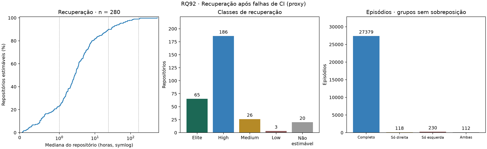
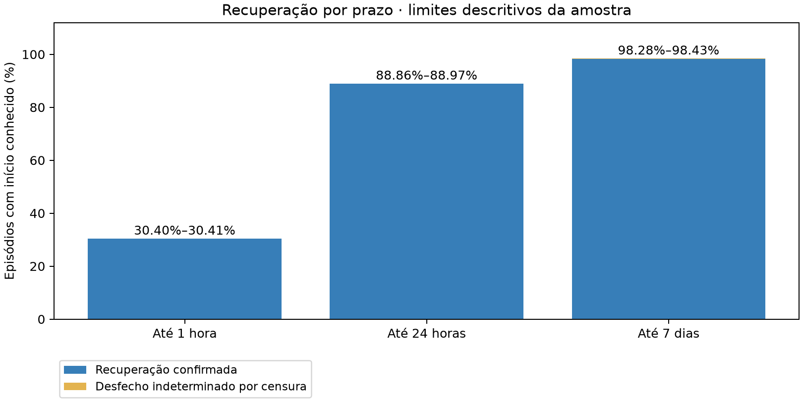

# RQ92 — RQ04: Tempo de recuperação após falhas

## Pergunta e método

Qual o tempo de recuperação após uma execução de CI/CD com falha? Análise local de **300 repositórios**, janela UTC inclusiva 2025-10-01 a 2026-09-30, **ainda não confirmada pelo professor na configuração**.

Somente runs criados na janela, do default branch e disparados por push. Success encerra um episódio; failure, timed_out e startup_failure indicam falha; demais conclusões são ignoradas. Cada workflow é ordenado separadamente. Falhas consecutivas formam um único episódio: início da primeira falha até updated_at do sucesso seguinte. Usa-se run_started_at (fallback created_at, conforme o módulo de métricas). A mediana do repositório considera todos os episódios completos dos seus workflows; a estatística da amostra é a mediana dessas medianas, com igual peso por repositório. Não é a mediana de todos os episódios agrupados.

Primeira falha sem sucesso anterior observado é marcada como censura à esquerda pelo projeto. Episódio não recuperado no corte é censurado à direita. Esses registros permanecem no CSV, mas não entram no cálculo pontual de recuperação. Durações censuradas são limites observados, não tempos finais. Um repositório sem episódio completo recebe **Não estimável**, nunca zero ou Elite.

## Resultados e análise escrita

Há **280 repositórios com tempo estimável** e **20 sem estimativa**. A mediana das medianas é **2.7157 horas**; Q1–Q3 = **1.1143–6.8524 horas** e IQR = **5.7381 horas**. Mínimo–máximo = 0.0653–560.0011 horas. Quartis usam interpolação linear; extremos permanecem na amostra.

| Classe de recuperação | Repositórios | % de toda a amostra |
|---|---:|---:|
| Elite | 65 | 21.67% |
| High | 186 | 62.00% |
| Medium | 26 | 8.67% |
| Low | 3 | 1.00% |
| Não estimável | 20 | 6.67% |

Faixas da disciplina: Elite < 1 h; High ≥ 1 h e < 24 h; Medium ≥ 24 h e < 168 h; Low ≥ 168 h. Estas classes representam somente recuperação, não a classificação DORA geral. O CSV inclui percentuais sobre a amostra toda e, separadamente, sobre os estimáveis.

## Censura e cobertura

- Runs lidos: 948146; válidos após filtros: 861659.
- Episódios: **27839**, dos quais **27379 completos**.
- Censura à direita: **230**; à esquerda: **342**; ambas: **112**.
- União de censuras: **460**. Direita e esquerda não devem ser somadas sem descontar a interseção.
- Proporção global à direita: **0.8262%** dos episódios.
- Entre os 286 repositórios com episódios, proporção de censura à direita: mediana **0.0000**, Q1–Q3 **0.0000–0.0194** (frações de 0 a 1).
- Situações por repositório: {"estimável": 280, "sem episódio": 14, "somente censura": 6}.

A proporção global pesa mais os projetos com muitos episódios; a mediana das proporções dá igual peso a cada repositório com episódios. Por isso, os dois indicadores respondem a perguntas distintas. Repositórios sem episódios ficam fora do denominador da proporção, sem receber artificialmente censura zero.

## Auditoria do encerramento da janela

As métricas originais foram reconstituídas a partir dos runs e conferidas com o CSV de entrada (tolerância de exportação: seis casas decimais). Depois da reconciliação, a RQ92 aplica o corte temporal: **4 episódios** cujo sucesso terminou após a janela passam a censurados. Foram excluídos **1 episódios** cujo início real só ocorreu após o corte. **4 repositórios** tiveram ajuste no encerramento. O arquivo auditoria_corte.csv mostra antes/depois, incluindo medianas e contagens. Os dados coletados e as métricas exportadas originais não são sobrescritos; esta correção deve ser considerada antes de reutilizar a classe de recuperação original em outras RQs.

## Confronto com H4 e interpretação

A H4 em artigo/introducao.tex previa recuperação mediana entre uma hora e um dia (High), cauda longa e censura abaixo de 10%. Resultado para a faixa de recuperação prevista: **compatível**. A tabela e a distribuição mostram a heterogeneidade sem equiparar todos os projetos ao comportamento da mediana. O máximo de 560.0011 horas, comparado ao Q3 de 6.8524 horas, permite avaliar a extensão da cauda.

A censura à direita global está **abaixo de 10%**, mas **24 repositórios** apresentam pelo menos 10% de censura à direita. Logo, uma baixa proporção global não implica cobertura adequada em todos os projetos. A contagem por repositório e a separação de casos não estimáveis são necessárias para interpretar a H4.

A censura é apresentada tanto globalmente quanto por repositório, sem escolher posteriormente o denominador mais favorável à hipótese. Essa comparação é descritiva; não prova que toda falha se recupera no mesmo dia. As medianas são condicionadas a episódios completos: excluir durações desconhecidas do cálculo pode favorecer episódios curtos, especialmente em projetos com alta censura. Não atribuímos aos censurados a duração até o corte como se fossem recuperações e não estimamos tempos desconhecidos.

## Recuperação por prazo: o que é observado e o que permanece desconhecido

Para complementar a mediana, avaliamos se cada episódio se recuperou em até **1 h, 24 h e 168 h**. Excluímos os 342 episódios sem início conhecido. Entre os restantes, um sucesso até o prazo confirma recuperação; uma duração completa acima do prazo ou censura direita no/depois do prazo confirma que não houve recuperação até ali. Censura antes do prazo deixa o desfecho indeterminado.

O limite inferior é recuperados/n; o superior é (recuperados + indeterminados)/n. São limites descritivos dos desfechos da amostra, **não intervalos de confiança**, previsões ou estimativas de sobrevivência. Não imputamos data de recuperação. A coluna de peso igual calcula a média dos limites de cada repositório com início conhecido; a coluna por episódio pesa mais projetos com muitos episódios. Nenhuma substitui a mediana principal.

| Prazo | Episódios | Recuperados | Indeterminados | Limites por episódio | Limites com peso igual por repositório |
|---|---:|---:|---:|---|---|
| 1 h | 27497 | 8358 | 5 | 30.40%–30.41% | 33.84%–33.86% |
| 24 h | 27497 | 24435 | 28 | 88.86%–88.97% | 79.21%–79.73% |
| 168 h | 27497 | 27023 | 41 | 98.28%–98.43% | 93.85%–94.54% |

Em 24 horas, a recuperação confirmada corresponde a **88.86% dos episódios**, versus **79.21% com peso igual por repositório**. A diferença mostra por que a resposta sobre um episódio e a resposta sobre um projeto não devem ser confundidas. Os limites superiores correspondentes são 88.97% e 79.73%; o intervalo incorpora apenas os desfechos indeterminados entre os episódios de início conhecido.

Os horizontes incluem o instante exato (≤). Isso é diferente dos cortes estritos de classe DORA (< 1 h, < 24 h, < 168 h); o resultado por prazo não reclassifica repositórios. Um intervalo estreito indica pouca indeterminação por censura direita naquele prazo, não ausência de viés de seleção ou de censura esquerda.

## Robustez à quantidade de episódios completos

Uma mediana baseada em um único episódio oferece menos evidência que uma baseada em dezenas. Recalculamos a estatística em subconjuntos exploratórios com no mínimo 5 e 10 episódios completos. São limiares de diagnóstico, não critérios novos de inclusão nem confirmação da H4.

| Mínimo de completos | Repositórios | Excluídos da amostra de 300 | Mediana (h) | IQR (h) |
|---|---:|---:|---:|---:|
| 1 | 280 | 20 | 2.7157 | 5.7381 |
| 5 | 246 | 54 | 2.7157 | 4.6591 |
| 10 | 219 | 81 | 2.7692 | 4.3576 |

Comparação das medianas: **mínimo 1: 2.7157 h (n=280); mínimo 5: 2.7157 h (n=246); mínimo 10: 2.7692 h (n=219)**. Essa leitura permite verificar se o valor central depende fortemente de projetos com poucos episódios completos, sem redefinir a amostra oficial.

Os subconjuntos podem conter projetos de perfis diferentes. Alterações na mediana não demonstram que aumentar o número de falhas melhora ou piora a recuperação. A análise principal continua incluindo todos os repositórios estimáveis; a censura é mantida nas saídas e no diagnóstico de cobertura.

## Limitações

Falha de CI não equivale a incidente em produção. O tempo inclui espera até nova execução, agendamento e duração do pipeline, não apenas trabalho ativo de reparo. Não há evidência aqui para atribuir caudas longas especificamente a workflows secundários. Execuções concorrentes, reexecuções e updated_at como aproximação do término limitam a interpretação; o CSV contém o estado coletado, não um histórico completo de mudanças de estado. O agrupamento segue o módulo existente por workflow e início da execução. Repositórios populares, filtros de inclusão e limite de runs geram seleção não probabilística. A censura à esquerda reflete falta de histórico anterior, não necessariamente o início real da falha. IQR é dispersão, não intervalo de confiança.

## Reprodução e dicionário das saídas

`python codigo-fonte/analise/rq92_tempo_recuperacao.py`

Opções: --entrada (pasta da coleta) e --saida (destino). Não exige token ou rede.

- repositorios.csv: nome_completo; runs_validos; episodios/completos/censura_direita/censura_esquerda/censura_ambas/censura_qualquer (contagens); proporcao_censura_* (fração, vazio sem episódios); recuperacao_mediana_horas (vazio sem completos); classe_recuperacao e situacao_repositorio.
- episodios.csv: repositório, workflow_id, inicio/fim UTC, falhas (runs no episódio), horas (duração completa ou parcial), censurado (direita), censura_esquerda, sucesso_apos_janela, completo e situacao (grupos exclusivos).
- auditoria_corte.csv: repositório, sucessos_apos_janela e episodios_iniciados_apos_janela (contagens), medianas antes/depois em horas, completos e censuras à direita antes/depois.
- classes_dora.csv: classe, contagem e percentuais (amostra total e somente estimáveis); Não estimável não recebe percentual entre estimáveis.
- resumo.json: estatísticas, cobertura, censura, auditoria e SHA-256 das entradas. Campos sem estimativa são null.
- recuperacao_censura.png/.svg: distribuição acumulada das medianas, classes e episódios sem dupla contagem.
- horizontes_por_repositorio.csv: nome_completo, horizonte_horas, episodios (início conhecido), recuperados/indeterminados/nao_recuperados (contagens), limite_inferior e limite_superior (frações).
- horizontes_resumo.csv: mesmos totais por horizonte, repositorios incluídos, limites por episódio e limites *_peso_igual (média por repositório), episodios_excluidos_inicio_desconhecido.
- robustez_cobertura.csv: minimo_completos (limiar), excluidos, n e mediana/q1/q3/iqr/minimo/maximo em horas. Campos sem dados ficam vazios.
- horizontes_recuperacao.png/.svg: limites descritivos por prazo; não são intervalos de confiança.

Referências locais: enunciado LAB03, seções 3 e 5 (RQ04); metricas/ci.py; metricas/dora.py; H4 registrada em entregas/laboratorio-03/artigo/introducao.tex.
