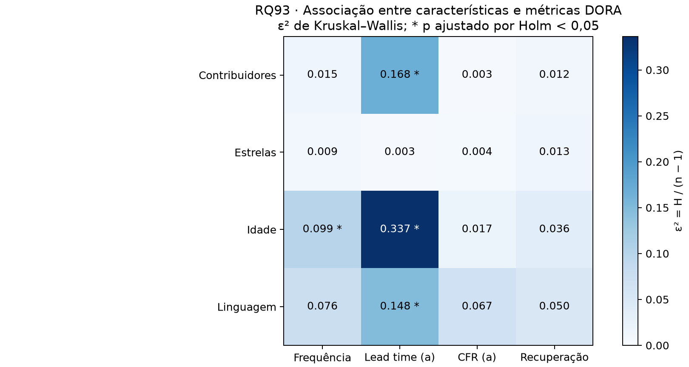

# RQ93 — RQ06: Características dos repositórios e desempenho DORA

## Pergunta e estratégia

Quais características estão associadas ao desempenho DORA? Foram analisados **300 repositórios** na janela 2025-10-01 a 2026-09-30, **ainda não confirmada pelo professor na configuração**. Há quatro fatores, superando o mínimo de três: contribuidores, estrelas, idade e linguagem. O tipo de projeto não foi inferido por IA: o consenso humano necessário não está disponível. Essa parte da H6 permanece pendente.

Métricas: frequência (releases/semana), lead time (a) por release (dias), CFR (a) de CI (fração) e recuperação (horas). Recuperação: RQ92, com ajuste do fim da janela e censura; hash da coleta reconciliado. Valores ausentes não são zero. A frequência maior e as demais métricas menores representam desempenho mais favorável sob esses proxies. Não foi criado um índice global que misture unidades. Variantes de lead time/CFR e sensibilidade de definições são tratadas pelas demais RQs.

## Método reproduzível

Quartis são calculados uma única vez na amostra disponível de cada fator, antes de remover valores ausentes das métricas. Q1 ≤ P25; Q2 > P25 e ≤ P50; Q3 > P50 e ≤ P75; Q4 > P75. Empates nunca são separados artificialmente: grupos podem ficar desbalanceados ou vazios. Cortes: `{"contribuidores_total": [188.75, 410.5, 862.5], "estrelas": [44858.0, 56822.5, 83008.5], "idade_anos": [2.521482, 6.408286, 10.742063]}`. Idade e demais metadados refletem a coleta; não garantem precedência temporal às métricas.

Todas as linguagens e grupos aparecem nas descritivas. Para teste, exigem-se pelo menos **5 valores válidos por grupo e métrica**. Grupos menores ficam registrados e excluídos daquele teste, sem juntar linguagens heterogêneas em “Outras”. Exclusões constam nos CSVs. Os testes com ≥3 grupos usam Kruskal–Wallis (correção de empates) e ε² = H/(n−1), conforme o enunciado. Com dois grupos, Mann–Whitney bilateral assintótico, correções de empates e continuidade, e δ = 2U₁/(n₁n₂)−1. Entradas globalmente constantes no KW recebem H=0 e p=1.

Família principal: **16 testes fator × métrica**, corrigidos juntos por Holm, α=0,05. Não se corrige separadamente cada fator. Testes não estimáveis ficam sem p. Família secundária: **292 pares elegíveis**, definidos sem selecionar pelos resultados, corrigidos juntos por Holm. Um par só é destacado se tanto o teste global quanto o par passam suas correções. Essas são duas famílias distintas; não se afirma controle conjunto entre ambas.

Cliff δ positivo significa valores maiores em A que em B; isso é favorável para frequência e desfavorável para tempos/CFR. Magnitude de |δ|: <0,147 desprezível; <0,33 pequeno; <0,474 médio; demais grande. Não aplicamos esses cortes a ε². KW detecta diferenças de distribuições/ranks e não identifica sozinho os pares nem prova diferença de medianas quando as formas diferem.

## Resultados

**4 de 16 testes principais** permanecem significativos após Holm. Significância não significa causalidade nem efeito relevante; os tamanhos de efeito devem ser lidos junto dos p-valores.

- **contribuidores_total × Lead time (a)**: epsilon²=0.1682, p Holm=1.033e-09. Há evidência de diferenças entre as distribuições dos grupos; os pares abaixo delimitam quais contrastes têm suporte.
- **idade_anos × Frequência**: epsilon²=0.09885, p Holm=2.395e-05. Há evidência de diferenças entre as distribuições dos grupos; os pares abaixo delimitam quais contrastes têm suporte.
- **idade_anos × Lead time (a)**: epsilon²=0.3365, p Holm=1.835e-20. Há evidência de diferenças entre as distribuições dos grupos; os pares abaixo delimitam quais contrastes têm suporte.
- **linguagem × Lead time (a)**: epsilon²=0.148, p Holm=9.073e-05. Há evidência de diferenças entre as distribuições dos grupos; os pares abaixo delimitam quais contrastes têm suporte.

| Fator | Métrica | n | Grupos | Teste | p bruto | p Holm | Efeito | Significativo |
|---|---|---:|---:|---|---:|---:|---|---|
| contribuidores_total | Frequência | 300 | 4 | Kruskal–Wallis | 0.2221 | 1 | epsilon²: 0.01469 | não |
| contribuidores_total | Lead time (a) | 300 | 4 | Kruskal–Wallis | 6.884e-11 | 1.033e-09 | epsilon²: 0.1682 | sim |
| contribuidores_total | CFR (a) | 300 | 4 | Kruskal–Wallis | 0.803 | 1 | epsilon²: 0.00332 | não |
| contribuidores_total | Recuperação | 280 | 4 | Kruskal–Wallis | 0.3563 | 1 | epsilon²: 0.01161 | não |
| estrelas | Frequência | 300 | 4 | Kruskal–Wallis | 0.451 | 1 | epsilon²: 0.00882 | não |
| estrelas | Lead time (a) | 300 | 4 | Kruskal–Wallis | 0.7971 | 1 | epsilon²: 0.003402 | não |
| estrelas | CFR (a) | 300 | 4 | Kruskal–Wallis | 0.7406 | 1 | epsilon²: 0.004187 | não |
| estrelas | Recuperação | 280 | 4 | Kruskal–Wallis | 0.2916 | 1 | epsilon²: 0.01338 | não |
| idade_anos | Frequência | 300 | 4 | Kruskal–Wallis | 1.711e-06 | 2.395e-05 | epsilon²: 0.09885 | sim |
| idade_anos | Lead time (a) | 300 | 4 | Kruskal–Wallis | 1.147e-21 | 1.835e-20 | epsilon²: 0.3365 | sim |
| idade_anos | CFR (a) | 300 | 4 | Kruskal–Wallis | 0.1613 | 1 | epsilon²: 0.01722 | não |
| idade_anos | Recuperação | 280 | 4 | Kruskal–Wallis | 0.01749 | 0.206 | epsilon²: 0.03631 | não |
| linguagem | Frequência | 286 | 11 | Kruskal–Wallis | 0.01716 | 0.206 | epsilon²: 0.07586 | não |
| linguagem | Lead time (a) | 286 | 11 | Kruskal–Wallis | 6.979e-06 | 9.073e-05 | epsilon²: 0.148 | sim |
| linguagem | CFR (a) | 286 | 11 | Kruskal–Wallis | 0.03803 | 0.3803 | epsilon²: 0.0673 | não |
| linguagem | Recuperação | 267 | 11 | Kruskal–Wallis | 0.2007 | 1 | epsilon²: 0.05048 | não |

## Quais grupos diferem?

Há **11 pares sustentados** por ambos os critérios. Abaixo, até 20 pares ordenados por p ajustado; todos os pares, inclusive não significativos, constam em comparacoes_pares.csv. Medianas têm a unidade da métrica, CFR em fração.

| Fator | Métrica | A × B | Mediana A × B | δ e magnitude | p Holm |
|---|---|---|---|---|---:|
| idade_anos | Lead time (a) | Q1 × Q4 | 2.668 × 44.03 | -0.8204 (grande) | 1.247e-15 |
| idade_anos | Lead time (a) | Q1 × Q3 | 2.668 × 17.52 | -0.6501 (grande) | 1.856e-09 |
| contribuidores_total | Lead time (a) | Q1 × Q4 | 5.457 × 35.6 | -0.5844 (grande) | 1.912e-07 |
| idade_anos | Lead time (a) | Q2 × Q4 | 8.796 × 44.03 | -0.5723 (grande) | 4.244e-07 |
| contribuidores_total | Lead time (a) | Q2 × Q4 | 8.199 × 35.6 | -0.5026 (grande) | 3.139e-05 |
| idade_anos | Frequência | Q1 × Q4 | 0.863 × 0.3452 | 0.4946 (grande) | 4.916e-05 |
| idade_anos | Lead time (a) | Q1 × Q2 | 2.668 × 8.796 | -0.4528 (médio) | 0.0004894 |
| linguagem | Lead time (a) | C++ × Python | 96.69 × 4.959 | 0.7778 (grande) | 0.0009326 |
| linguagem | Lead time (a) | C++ × TypeScript | 96.69 × 9.055 | 0.7365 (grande) | 0.001764 |
| contribuidores_total | Lead time (a) | Q1 × Q3 | 5.457 × 14.11 | -0.3799 (médio) | 0.01687 |
| idade_anos | Frequência | Q1 × Q3 | 0.863 × 0.3452 | 0.3572 (médio) | 0.0452 |

## Confronto com H6

A H6 original em artigo/introducao.tex prevê, para mais contribuidores, maior frequência, menor recuperação e maior CFR (a). O confronto Q1–Q4 é:

- Efeitos: 10 de 16 testes KW apresentam ε² < 0,06, conforme o limiar previsto na H6.
- linguagem, Frequência: efeito 0.07586; p Holm 0.206; sem evidência de associação após ajuste.
- estrelas, Frequência: efeito 0.00882; p Holm 1; sem evidência de associação após ajuste.
- estrelas, Lead time (a): efeito 0.003402; p Holm 1; sem evidência de associação após ajuste.
- estrelas, CFR (a): efeito 0.004187; p Holm 1; sem evidência de associação após ajuste.
- estrelas, Recuperação: efeito 0.01338; p Holm 1; sem evidência de associação após ajuste.
- Contribuidores, Frequência: Q1 mediana 0.4411; Q4 0.537 releases/semana; par sem evidência ajustada.
- Contribuidores, Recuperação: Q1 mediana 2.303; Q4 3.044 horas; par sem evidência ajustada.
- Contribuidores, CFR (a): Q1 mediana 0.04403; Q4 0.05234 fração; par sem evidência ajustada.

A comparação acima distingue direção descritiva de evidência ajustada: uma ordenação das medianas sem par significativo não confirma a previsão. A tabela principal também permite confrontar associação entre linguagem e frequência e o efeito esperado das estrelas. Ausência de significância não demonstra equivalência ou efeito zero. O critério ε² < 0,06 previsto na H6 deve ser confrontado numericamente, não trocado por um novo corte após os resultados. A previsão sobre bibliotecas versus aplicações/CLI não foi testada sem rótulos humanos.

## Limitações e interpretação

As associações são observacionais, univariadas e não ajustadas por confundidores. Linguagem, idade, popularidade e contribuidores podem estar associados entre si. A amostra não probabilística de projetos populares e os filtros da coleta restringem generalização; projetos relacionados podem violar independência. Dados ausentes e exclusões de grupos pequenos mudam o conjunto em cada teste. A recuperação considera somente episódios completos, com a censura documentada na RQ92; lead time e CFR também são proxies, não medidas diretas de produção. A significância assintótica pode ser frágil em grupos pequenos mesmo com o piso de cinco observações. A divisão em quartis perde informação; não representa um ponto de corte causal.

## Reprodução e dicionário

Na raiz: `python codigo-fonte/analise/rq93_caracteristicas_dora.py`.
Opções: --entrada, --saida e --recuperacao (CSV da RQ92 acompanhado de resumo.json). Para usar explicitamente a referência original: --usar-recuperacao-original. A execução padrão exige a RQ92 atualizada e valida a janela e o hash do CSV original antes de integrar seu ajuste.

- repositorios_grupos.csv: nomes, fatores brutos, grupos e quatro métricas nas unidades acima.
- descritivas_grupos.csv: fator/métrica/grupo, n_grupo, n_valido, ausentes, mediana/Q1/Q3/IQR e elegivel_teste; inclui grupos pequenos.
- testes_holm.csv: n, k, excluidos, grupos, status, teste, estatistica H/U, p, p_holm, efeito e tipo, rejeita_005 e tamanho da família.
- comparacoes_pares.csv: grupos A/B, n e medianas, U, p, δ e magnitude, p_holm e sinalizadores de significância global/por par/conjunta dos critérios.
- resumo.json: configuração, cortes, contagens e hashes de todas as fontes usadas.
- efeitos_dora.png/.svg: ε² dos testes KW; MW não é misturado na mesma escala.

## Referências de implementação

- Enunciado LAB03, seção 5, RQ06: quartis, ε², Cliff δ e correção de Holm.
- [SciPy: Kruskal–Wallis](https://docs.scipy.org/doc/scipy/reference/generated/scipy.stats.kruskal.html): teste, empates e tamanhos de grupo.
- [Statsmodels: multipletests](https://www.statsmodels.org/stable/generated/statsmodels.stats.multitest.multipletests.html): ajuste Holm.
