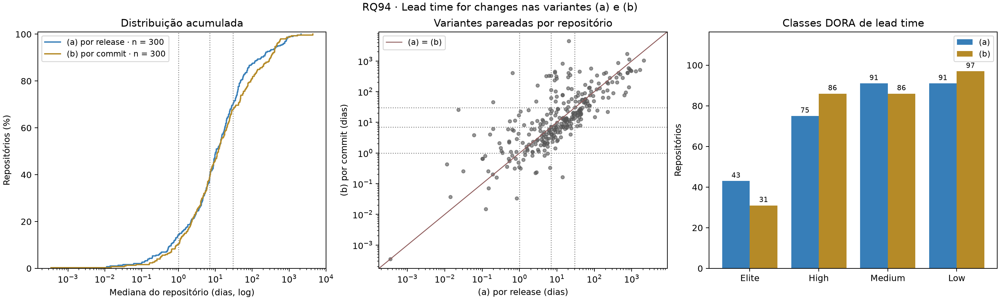
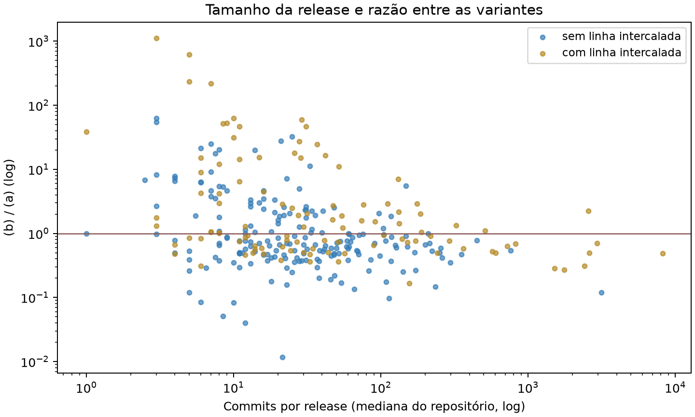

# RQ94 — RQ02: Lead time for changes nas duas variantes

## Pergunta e método

Qual o tempo entre um commit e seu respectivo deploy, por release e por commit? Análise local de **300 repositórios**, janela UTC inclusiva 2025-10-01 a 2026-09-30, **ainda não confirmada pelo professor na configuração**.

Para cada release R da janela (publicada, não draft, não pré-release), os commits são os do intervalo entre a release publicada imediatamente anterior e R (clone git parcial; `fonte_commits = git` em todos os repositórios). Data do commit = `commit.author.date`; data de R = `published_at`.

- **(a) por release:** lead time de R = data de R − commit mais antigo de R; valor do repositório = mediana entre as releases.
- **(b) por commit:** cada commit de R contribui com data de R − data dele; valor do repositório = mediana de **todos** os commits de todas as releases (não é mediana de medianas).

Estatística da amostra: mediana das medianas dos repositórios, Q1/Q3 por interpolação linear e IQR. Classes pelos cortes da disciplina: Elite < 1 dia; High 1 a < 7; Medium 7 a < 30; Low ≥ 30 dias.

## Cobertura e auditoria

- Releases na janela: **18206**; com lead time: **14589**.
- Ignoradas: **57** primeira release da história (sem anterior) e **3560** sem commits novos. Compare indisponível: 0; truncado: 0.
- Commits com lead time: **5202383**; descartados por data de autoria posterior à release: **890**.
- A variante (a) foi **recalculada** a partir de `lead_time_releases.csv` e bate com `metricas_repositorios.csv` em todos os repositórios (tolerância de seis casas), assim como as contagens de releases e commits e a classe de lead time.
- A variante (b) **não pode ser recalculada** aqui: o arquivo por commit (`commits_releases.csv.gz`) passa de 100 MB e não foi versionado. O valor exportado foi conferido pela soma dos commits por release e pelos limites da definição (0 ≤ (b) ≤ maior lead time (a) do repositório).

## Resultados

| Variante | n | Mediana (dias) | Q1–Q3 | IQR | Mín.–máx. |
|---|---:|---:|---:|---:|---:|
| (a) por release | 300 | 10.47 | 3.56–39.46 | 35.91 | 0.0003–2109.74 |
| (b) por commit | 300 | 12.06 | 3.28–57.53 | 54.25 | 0.0003–4464.67 |
| (a) sem linhas intercaladas | 298 | 10.14 | 3.03–38.50 | 35.47 | 0.0003–3383.37 |

| Classe | (a) por release | (b) por commit | (a) sem linhas intercaladas |
|---|---:|---:|---:|
| Elite | 43 (14.3%) | 31 (10.3%) | 43 (14.4%) |
| High | 75 (25.0%) | 86 (28.7%) | 74 (24.8%) |
| Medium | 91 (30.3%) | 86 (28.7%) | 92 (30.9%) |
| Low | 91 (30.3%) | 97 (32.3%) | 89 (29.9%) |

### Comparação pareada

Em **177 repositórios** a (b) é menor que a (a), em **122** é maior e em **1** é igual. A razão (b)/(a) tem mediana **0.78** (Q1–Q3 0.50–2.32). Wilcoxon pareado (a vs. b): W = 20069.0, p = 0.1153, correlação rank-bisserial = 0.105 (positiva = (a) maior).

**127 repositórios (42.3%) mudam de classe** ao trocar (a) por (b): 61 melhoram e 66 pioram. Matriz de transição (linhas: (a); colunas: (b)):

| (a) \ (b) | Elite | High | Medium | Low |
|---|---:|---:|---:|---:|
| **Elite** | 21 | 16 | 4 | 2 |
| **High** | 9 | 44 | 15 | 7 |
| **Medium** | 1 | 26 | 42 | 22 |
| **Low** | 0 | 0 | 25 | 66 |

Por que a (b) pode ser **maior** que a (a)? Em cada release, o lead time de cada commit é no máximo o da (a). Mas a (b) do repositório pondera as releases pelo número de commits, e a (a) dá peso igual a cada release. Quando poucas releases grandes concentram commits antigos e muitas releases pequenas são rápidas, a mediana por commit cai dentro das releases grandes e supera a mediana por release.

### Tamanho da release

- Por release: Spearman entre commits e lead time (a): ρ = 0.821 (p = 0.0000, n = 14589). Quanto mais commits, mais distante tende a estar o commit mais antigo, o que é quase mecânico na definição (a).
- Por repositório: Spearman entre a mediana de commits por release e a razão (b)/(a): ρ = -0.302 (p = 0.0000, n = 300); e a diferença (a) − (b) em dias: ρ = 0.385 (p = 0.0000).

### Linhas de release intercaladas

A "release anterior" é a anterior **por data**. Em projetos com várias linhas de manutenção (backports) ou monorepos, ela pode ser de outra linha, e o intervalo de commits passa a misturar trabalho que não pertence a R. Diagnosticamos isso pela tag (prefixo e números da versão): das releases com lead time, 12579 avançam a versão da anterior, **728 regridem** (backport numa linha mais antiga), **1277 são de outra série** (prefixo diferente) e 5 não têm versão numérica.

As 2005 releases intercaladas estão em **106 repositórios** e somam **840209 commits**. Os 10 repositórios com mais commits concentram **75.4%** de todos os commits:

| Repositório | Commits | Releases intercaladas | (a) dias | (b) dias |
|---|---:|---:|---:|---:|
| ClickHouse/ClickHouse | 1838730 | 78 | 321.18 | 90.72 |
| frappe/erpnext | 1157716 | 61 | 980.91 | 476.38 |
| n8n-io/n8n | 215560 | 0 | 14.20 | 78.65 |
| nuxt/nuxt | 131906 | 13 | 759.25 | 1717.60 |
| php/php-src | 113070 | 15 | 824.90 | 582.58 |

Como análise de robustez (não substitui a definição comum da turma), recalculamos a (a) sem as releases intercaladas: mediana **10.14 dias** (n = 298); **11 repositórios** mudam de classe e 2 ficam sem release. A (b) não pode ser refeita sem o arquivo por commit.

## Confronto com H2

A H2 previa (a) com mediana na faixa de semanas (Medium, muitas vezes Low) e (b) sistematicamente menor, na faixa de dias, com diferença crescente com o tamanho das releases.

- **(a):** mediana de 10.47 dias, classe Medium; Medium e Low somam 182 repositórios. Faixa prevista: **compatível**.
- **(b) sistematicamente menor que (a):** **não confirmada**. A mediana da amostra na (b) é 12.06 dias (classe Medium), acima da (a). A (b) é menor em 177 repositórios (maioria), mas maior em 122, e o Wilcoxon pareado não rejeita a igualdade a 5% (rank-bisserial 0.105). Não há deslocamento para a faixa de dias.
- **Diferença cresce com o tamanho das releases:** compatível: quanto maiores as releases, menor a (b) em relação à (a), isto é, a distância entre as variantes cresce com o tamanho (ρ = -0.302 entre commits por release e (b)/(a)). O mecanismo da H2 (um commit antigo "explode" a (a) e a (b) o dilui) aparece nos repositórios de releases grandes; nos de releases pequenas, a ponderação por commit faz a (b) superar a (a) (ver explicação acima).

A troca de variante muda a classe de 127 repositórios. Esse dado alimenta a RQ07 (sensibilidade): o lead time sozinho já desloca a classificação de uma parte relevante da amostra.

## Limitações

Release publicada é proxy de deploy; numa biblioteca, quem faz deploy é o usuário. `commit.author.date` é preservada em rebase e cherry-pick, o que alonga o lead time de commits reaproveitados. A ordem por data mistura linhas de release (seção acima); a definição comum da turma foi mantida e o efeito é reportado à parte. A heurística de linha intercalada lê só a tag e pode errar em esquemas de versão sem número ou com datas. A (b) foi verificada, mas não recalculada. Seleção de repositórios populares, não probabilística. IQR é dispersão, não intervalo de confiança.

## Reprodução e dicionário das saídas

`python codigo-fonte/analise/rq94_lead_time.py` (opções `--entrada` e `--saida`). Não exige token nem rede.

- repositorios.csv: nome_completo, linguagem; releases_janela, releases_com_lead_time, releases_sem_anterior, releases_sem_commits (contagens); commits_com_lead_time, commits_negativos (contagens); commits_por_release_mediana (commits); lead_time_a_dias, lead_time_a_q1_dias, lead_time_a_q3_dias, lead_time_a_max_dias e lead_time_b_dias (dias); classe_lead_time_a/b; diferenca_a_menos_b_dias (dias); razao_b_sobre_a (adimensional); b_menor_que_a, mudou_classe (booleanos); passos_classe_b_menos_a (−3 a 3, positivo = (b) melhora); releases_linha_intercalada (contagem); lead_time_a_sem_intercaladas_dias (dias) e classe_lead_time_a_sem_intercaladas.
- releases.csv: uma linha por release da janela; commits, commits_negativos, commits_validos (contagens), lead_time_dias (a, dias; vazio sem lead time), motivo, relacao_anterior (avanco, regressao, serie_diferente, sem_versao) e linha_intercalada.
- estatisticas.csv: variante, n, mediana, q1, q3, iqr, minimo, maximo (dias; a razão é adimensional).
- classes_dora.csv: variante (a, b, a_sem_intercaladas), classe, repositórios e percentual sobre os classificados.
- transicoes_classes.csv: matriz classe (a) × classe (b), em repositórios.
- resumo.json: cobertura, estatísticas, comparação pareada, correlações, linhas intercaladas e SHA-256 das entradas. Campos sem estimativa são null.
- lead_time_variantes.png/.svg e tamanho_release.png/.svg.

Referências locais: enunciado LAB03, seções 3 e 5 (RQ02); metricas/lead_time.py; metricas/dora.py; H2 em entregas/laboratorio-03/artigo/introducao.tex.
