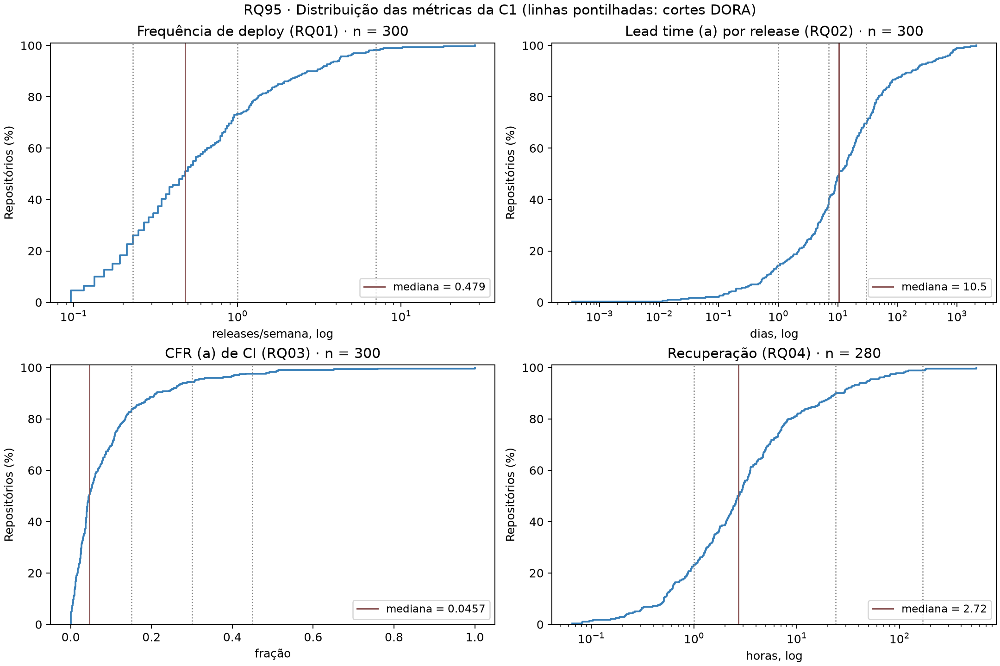
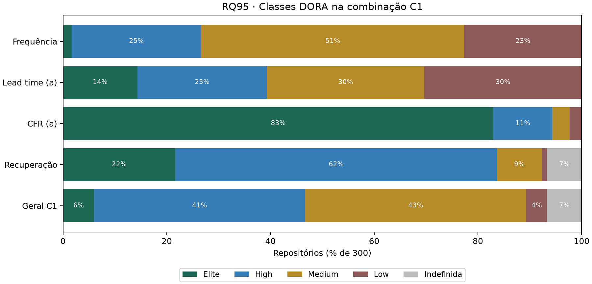

# RQ95 — Estatísticas descritivas, mediana, IQR e classificação DORA C1

## Escopo

Consolida, para os **300 repositórios** da amostra final, as estatísticas descritivas das quatro métricas DORA (RQ01 a RQ04) e a classificação na **combinação de referência C1**, que é a base de comparação da RQ07. Janela UTC inclusiva 2025-10-01 a 2026-09-30, **ainda não confirmada pelo professor na configuração**.

| Elemento | Definição na C1 |
|---|---|
| Deploy | Release publicada (`draft = false`), não pré-release |
| Frequência | Releases na janela / semanas da janela |
| Lead time | Variante (a): data da release − commit mais antigo; mediana entre releases |
| CFR | Variante (a): runs com falha / (falhas + sucessos), `event = push`, default branch |
| Recuperação | Mediana dos episódios completos de falha por workflow (horas) |
| Classe geral | Mediana das quatro notas (Elite 4 … Low 1), arredondada para baixo; indefinida se alguma métrica for indefinida |

Valores e classes vêm de `metricas_repositorios.csv`; as classes foram **recalculadas** com `metricas/dora.py` e conferem com as exportadas em todos os repositórios. O CFR (b) de entrega não entra na C1 e não é consolidado aqui.

## Estatísticas descritivas

Valores por repositório; estatística da amostra com igual peso por repositório. Quartis e percentis por interpolação linear. A média aparece só para mostrar a assimetria: ela fica muito acima da mediana em todas as métricas de tempo.

| Métrica | Unidade | n | Indefinidos | Mediana | Q1–Q3 | IQR | P10–P90 | Mín.–máx. | Média | Classe da mediana |
|---|---|---:|---:|---:|---:|---:|---:|---:|---:|---|
| Frequência de deploy (RQ01) | releases/semana | 300 | 0 | 0.479 | 0.230–1.155 | 0.925 | 0.152–2.706 | 0.0959–28.17 | 1.164 | Medium |
| Lead time (a) por release (RQ02) | dias | 300 | 0 | 10.47 | 3.56–39.46 | 35.91 | 0.64–174.18 | 0.0003–2109.74 | 82.10 | Medium |
| CFR (a) de CI (RQ03) | fração | 300 | 0 | 0.0457 | 0.0235–0.1114 | 0.0880 | 0.0073–0.2118 | 0.0000–1.00 | 0.0909 | Elite |
| Recuperação (RQ04) | horas | 280 | 20 | 2.72 | 1.11–6.85 | 5.74 | 0.51–24.49 | 0.0653–560.00 | 12.00 | High |
| Lead time (b) por commit (RQ02) | dias | 300 | 0 | 12.06 | 3.28–57.53 | 54.25 | 0.96–312.88 | 0.0003–4464.67 | 98.19 | Medium |

## Classificação DORA (C1)

| Métrica | Elite | High | Medium | Low | Indefinida |
|---|---:|---:|---:|---:|---:|
| Frequência | 5 (1.7%) | 75 (25.0%) | 152 (50.7%) | 68 (22.7%) | 0 (0.0%) |
| Lead time (a) | 43 (14.3%) | 75 (25.0%) | 91 (30.3%) | 91 (30.3%) | 0 (0.0%) |
| CFR (a) | 249 (83.0%) | 34 (11.3%) | 10 (3.3%) | 7 (2.3%) | 0 (0.0%) |
| Recuperação | 65 (21.7%) | 186 (62.0%) | 26 (8.7%) | 3 (1.0%) | 20 (6.7%) |
| **Geral C1** | 18 (6.0%) | 122 (40.7%) | 128 (42.7%) | 12 (4.0%) | 20 (6.7%) |

- A classe geral mais frequente é **Medium** (128 de 280 repositórios classificados). Elite e High somam 140 (50.0% dos classificados).
- **20 repositórios** ficam sem classe geral, todos por recuperação indefinida (sem episódio completo de falha: 20). Não recebem zero nem Elite. Como sensibilidade não oficial, a mediana das três métricas definidas os colocaria em: {"Elite": 1, "High": 6, "Medium": 7, "Low": 6}.
- **136 repositórios** têm mediana de notas não inteira (ex.: 3,5) e são arredondados para baixo; a regra é conservadora e desloca a distribuição para classes piores.
- O CFR (a) concentra **249 repositórios em Elite** (83.0%): com a mediana de 4.6% de falhas, o corte de 15% discrimina pouco. Frequência e lead time são as métricas que mais diferenciam os repositórios.

### Quem puxa a classe geral

Comparação entre a classe de cada métrica e a classe geral do repositório (só classificados):

| Métrica | Acima da geral | Igual | Abaixo da geral |
|---|---:|---:|---:|
| Frequência | 6 | 159 | 115 |
| Lead time (a) | 28 | 156 | 96 |
| CFR (a) | 231 | 40 | 9 |
| Recuperação | 165 | 109 | 6 |

### Velocidade e estabilidade

Perfil **alto** = Elite ou High nas duas métricas da dimensão; **baixo** = Medium ou Low nas duas; **misto** = uma de cada. Velocidade = frequência e lead time; estabilidade = CFR e recuperação.

| Velocidade \ Estabilidade | alto | misto | baixo |
|---|---:|---:|---:|
| **alto** | 54 | 5 | 0 |
| **misto** | 62 | 8 | 1 |
| **baixo** | 123 | 24 | 3 |

Entre os 280 repositórios com as quatro métricas definidas, **239 (85.4%) têm estabilidade alta**, mas só **59 (21.1%) têm velocidade alta**. Na C1, a classe geral é limitada pela velocidade: as métricas de estabilidade ficam acima da geral e as de velocidade, abaixo (tabela anterior). A tabela é descritiva; a associação entre as dimensões é objeto da RQ05.

### Combinações mais frequentes

62 combinações distintas de classes (Frequência/Lead time/CFR/Recuperação, pela inicial):

| Combinação (F/L/C/R) | Geral | Repositórios |
|---|---|---:|
| M/M/E/H | Medium | 34 |
| M/L/E/H | Medium | 23 |
| L/L/E/H | Medium | 21 |
| M/H/E/H | High | 16 |
| M/M/E/E | High | 16 |
| H/H/E/H | High | 15 |
| H/E/E/E | Elite | 9 |
| H/E/E/H | High | 9 |

## Sensibilidade ao corte da janela (RQ92)

Com a recuperação ajustada pela RQ92 (sucesso após o fim da janela vira censura), **3 repositórios** mudam de valor, **0** mudam de classe de recuperação e **0** mudam de classe geral. A C1 oficial mantém o valor exportado pela coleta; o ajuste não altera nenhuma classe.

## Limitações

As classes são da combinação C1; outras definições operacionais (pré-releases, tags, lead time (b), CFR (b)) são avaliadas na RQ07. Os cortes DORA vêm de questionários com empresas e não foram calibrados para projetos open-source. A mediana das notas trata as classes como equidistantes. A amostra é de repositórios populares que usam GitHub Actions, não probabilística. IQR é dispersão, não intervalo de confiança.

## Reprodução e dicionário das saídas

`python codigo-fonte/analise/rq95_estatisticas_c1.py` (opções `--entrada`, `--rq92` e `--saida`). Não exige token nem rede.

- estatisticas_descritivas.csv: metrica, rotulo, unidade; n e indefinidos (contagens); mediana, q1, q3, iqr, p10, p90, minimo, maximo, media (na unidade da métrica); classe_da_mediana.
- repositorios_c1.csv: nome_completo, linguagem, as quatro métricas e o lead time (b) (unidades acima); classe_* e nota_* (4 = Elite … 1 = Low) por métrica; classe_geral; mediana_notas (antes do arredondamento) e arredondado; perfil_velocidade e perfil_estabilidade (alto, misto, baixo; vazio se indefinido); classe_geral_metricas_definidas (sensibilidade, não oficial) e metricas_indefinidas (contagem); recuperacao_rq92_horas, classe_recuperacao_rq92 e classe_geral_rq92 (sensibilidade ao corte).
- classes_c1.csv: metrica, classe (inclui Indefinida), repositórios, percentual_amostra e percentual_definidos.
- perfis_velocidade_estabilidade.csv: repositórios por perfil de velocidade × estabilidade.
- combinacoes_classes.csv: combinação F/L/C/R, classe geral e repositórios.
- resumo.json: estatísticas, classes, indefinidos, arredondamentos, alinhamento, perfis, sensibilidade e SHA-256 das entradas. Campos sem estimativa são null.
- distribuicoes_c1.png/.svg e classes_c1.png/.svg.

Referências locais: metricas/dora.py; RQ91, RQ92 e RQ94 em entregas/laboratorio-03/sprint-03; Seção 2 de entregas/laboratorio-03/artigo/metodologia.tex.
