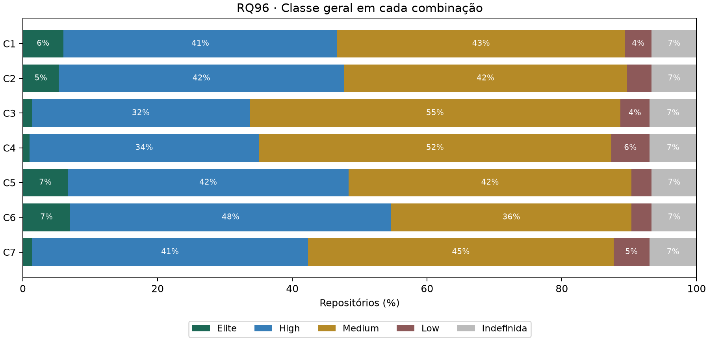
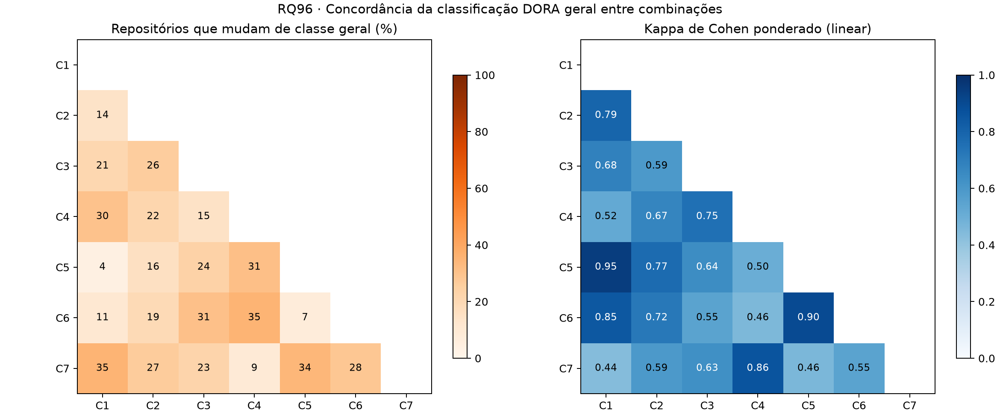

# RQ96 — RQ07: Sensibilidade das classificações DORA

## Pergunta e método

O quanto a classificação DORA de um repositório depende da definição operacional escolhida? Análise local de **300 repositórios**, janela UTC inclusiva 2025-10-01 a 2026-09-30, **ainda não confirmada pelo professor na configuração**.

Cada repositório é classificado em 7 combinações de definições. Em todas, a recuperação é a mesma (mediana dos episódios completos por workflow) e a classe geral é a mediana das quatro notas, arredondada para baixo, indefinida se alguma métrica for indefinida (regra da RQ95). A **C1 é a referência** e reproduz a `classe_geral` exportada em todos os repositórios.

| Combinação | Unidade de deploy | Lead time | CFR | Descrição | Classificados |
|---|---|---|---|---|---:|
| C1 | release | (a) | (a) | Referência: release, lead time por release, CFR de CI | 280 |
| C2 | release | (b) | (a) | Lead time por commit | 280 |
| C3 | release | (a) | (b) | CFR de entrega (release corretiva) | 279 |
| C4 | release | (b) | (b) | Lead time por commit e CFR de entrega | 279 |
| C5 | release_prerelease | (a) | (a) | Pré-releases contam como deploy | 280 |
| C6 | tag | (a) | (a) | Tags contam como deploy | 280 |
| C7 | tag | (b) | (b) | Tags, lead time por commit e CFR de entrega | 279 |

- **Pré-releases:** releases publicadas na janela com `prerelease = true` entram no numerador da frequência. Contagens conferidas com a coleta.
- **Tags:** tags cujo commit apontado tem `commit.author.date` na janela. A API não data a tag; a data do commit é uma aproximação que pode antecipar a tag.
- **CFR (b):** release seguida de corretiva em até 7 dias (inclusive), últimos 7 dias censurados, heurística `patch_semver_v1` (só a tag; **ainda sem F1 medido contra a amostra-ouro**). Mediana 18.8%, contra 4.6% do CFR (a); 1 repositório(s) sem release avaliável; 7130 releases com tag fora do SemVer estrito, que nunca são corretivas na v1.
- **Lead time** é sempre o da unidade release: recalculá-lo para pré-releases e tags exige os commits de cada intervalo (`commits_releases.csv.gz`, não versionado). Nas combinações C5 a C7, só a frequência muda com a unidade de deploy.

Por par de combinações: n de repositórios classificados nas duas, proporção que muda de classe geral, direção da mudança e kappa de Cohen ponderado com pesos lineares (`sklearn`), interpretado pela escala de Landis e Koch.

## Resultados

### Classe geral em cada combinação

| Combinação | Elite | High | Medium | Low | Indefinida |
|---|---:|---:|---:|---:|---:|
| C1 | 18 | 122 | 128 | 12 | 20 |
| C2 | 16 | 127 | 126 | 11 | 20 |
| C3 | 4 | 97 | 165 | 13 | 21 |
| C4 | 3 | 102 | 157 | 17 | 21 |
| C5 | 20 | 125 | 126 | 9 | 20 |
| C6 | 21 | 143 | 107 | 9 | 20 |
| C7 | 4 | 123 | 136 | 16 | 21 |

### C1 contra cada alternativa

| Par | n | Mudam | Melhoram | Pioram | Mudam ≥ 2 classes | Kappa linear | Landis e Koch |
|---|---:|---:|---:|---:|---:|---:|---|
| C1 × C2 | 280 | 40 (14.3%) | 21 | 19 | 0 | 0.794 | substancial |
| C1 × C3 | 279 | 58 (20.8%) | 3 | 55 | 0 | 0.684 | substancial |
| C1 × C4 | 279 | 83 (29.7%) | 18 | 65 | 6 | 0.523 | moderada |
| C1 × C5 | 280 | 10 (3.6%) | 10 | 0 | 0 | 0.949 | quase perfeita |
| C1 × C6 | 280 | 30 (10.7%) | 30 | 0 | 0 | 0.847 | quase perfeita |
| C1 × C7 | 279 | 99 (35.5%) | 38 | 61 | 6 | 0.437 | moderada |

Entre os 279 repositórios classificados em todas as combinações, **163 (58.4%) têm a mesma classe em todas** e **116 (41.6%) mudam em pelo menos uma alternativa** à C1.

### Demais pares

| Par | n | Mudam | Kappa linear |
|---|---:|---:|---:|
| C2 × C3 | 279 | 26.2% | 0.593 |
| C2 × C4 | 279 | 21.5% | 0.669 |
| C2 × C5 | 280 | 15.7% | 0.772 |
| C2 × C6 | 280 | 19.3% | 0.721 |
| C2 × C7 | 279 | 26.5% | 0.592 |
| C3 × C4 | 279 | 14.7% | 0.752 |
| C3 × C5 | 279 | 23.7% | 0.642 |
| C3 × C6 | 279 | 30.8% | 0.549 |
| C3 × C7 | 279 | 22.6% | 0.633 |
| C4 × C5 | 279 | 31.2% | 0.503 |
| C4 × C6 | 279 | 35.5% | 0.455 |
| C4 × C7 | 279 | 8.6% | 0.862 |
| C5 × C6 | 280 | 7.1% | 0.897 |
| C5 × C7 | 279 | 34.1% | 0.458 |
| C6 × C7 | 279 | 28.3% | 0.550 |

### Efeito de cada troca sobre a classe da própria métrica

| Troca | n | Mudam | Melhoram | Pioram | Kappa linear |
|---|---:|---:|---:|---:|---:|
| Frequência: release → release + pré-release | 300 | 34 (11.3%) | 34 | 0 | 0.846 |
| Frequência: release → tag | 300 | 72 (24.0%) | 72 | 0 | 0.665 |
| Lead time: (a) → (b) | 300 | 127 (42.3%) | 61 | 66 | 0.576 |
| CFR: (a) → (b) | 299 | 171 (57.2%) | 27 | 144 | 0.022 |

- Frequência mediana (releases/semana): release 0.479; com pré-releases 0.566; por tag 0.767. 128 repositórios têm pré-releases na janela. 214 têm mais tags que releases e 4, menos (tags datadas pelo commit podem cair fora da janela mesmo com a release dentro).
- A classe de uma métrica muda bem mais que a classe geral: a mediana de quatro notas absorve parte das trocas.

## Confronto com H7

A H7 previa classificação frágil: pelo menos 30% dos repositórios mudando de categoria geral entre a C1 e as alternativas, kappa ponderado entre 0,2 e 0,6, pré-releases e tags inflando a frequência e a troca do lead time (a) pelo (b) melhorando a classe de muitos repositórios.

- **≥ 30% mudam de classe geral:** confirmada em 1 de 6 alternativas (C7).
- **Kappa entre 0,2 e 0,6:** parcialmente fora da faixa prevista (de 0.437 a 0.949).
- **Pré-releases inflam a frequência:** sim; a classe de frequência melhora em 34 repositórios e nunca piora (pré-releases só somam).
- **Tags inflam a frequência:** sim; a classe melhora em 72 e piora em 0 repositórios.
- **Lead time (b) melhora a classe de muitos:** não confirmada; melhora em 61 e piora em 66 repositórios (ver RQ94: a (b) não é sistematicamente menor que a (a)).
- **CFR (b):** a classe de CFR muda em 171 repositórios (57.2%), melhorando em 27 e piorando em 144. Não havia previsão na H7; é a troca de maior efeito por métrica.

**H7 parcialmente confirmada.** A fragilidade depende de qual definição muda. Trocar só a unidade de deploy (C5, C6) muda de 3.6% a 10.7% das classes, sempre para melhor, com kappa de 0.847 a 0.949. As combinações com CFR (b) mudam de 20.8% a 35.5%, e 75% dessas mudanças são para pior, porque o CFR (a) concentra os repositórios em Elite e o CFR (b) não. Como a heurística do CFR (b) ainda não foi validada, parte desse efeito pode ser do proxy, e não da definição. Conclusões das RQ01 a RQ06 sobre a classe geral valem para a C1 e são sensíveis, sobretudo, à escolha do CFR.

## Limitações

As combinações não esgotam as definições possíveis; foram escolhidas as obrigatórias do enunciado que os dados versionados permitem calcular. Lead time não acompanha a unidade de deploy nas C5 a C7. O CFR (b) depende de uma heurística ainda não validada (F1 pendente na RQ89); se a versão padrão mudar, a RQ96 deve ser reexecutada. Tags datadas pelo commit, não pela criação. O kappa ponderado assume classes ordinais e equidistantes. Repositórios sem classe geral numa combinação ficam fora do par, então os n variam. A amostra não é probabilística.

## Reprodução e dicionário das saídas

`python codigo-fonte/analise/rq96_sensibilidade_dora.py` (opções `--entrada`, `--saida` e `--heuristica`). Não exige token nem rede.

- repositorios_combinacoes.csv: nome_completo, linguagem; releases_contadas, prereleases_contadas, tags_janela (contagens na janela); frequencia_release, frequencia_release_prerelease, frequencia_tag (releases/semana); lead_time_release_mediana_dias e lead_time_commit_mediana_dias (dias); cfr_ci e cfr_entrega (fração); releases_avaliadas_cfr, releases_falha_cfr, releases_sem_semver (contagens); recuperacao_mediana_horas (horas); classe_freq_*, classe_lead_*, classe_cfr_*, classe_recuperacao (classe de cada variante de métrica); C1 a C7 (classe geral); classes_distintas (nº de classes gerais diferentes entre as combinações), combinacoes_iguais_c1 (nº de alternativas com a mesma classe da C1), amplitude_notas (maior − menor nota geral).
- combinacoes.csv: combinacao, unidade_deploy, lead_time, cfr, descricao e repositorios_classificados.
- classes_combinacoes.csv: combinacao, classe (inclui Indefinida), repositórios e percentual entre os classificados.
- pares.csv: combinacao_1, combinacao_2, n, mudam, proporcao_mudam (fração), melhoram e pioram (na direção 1 → 2), mudam_2_ou_mais, kappa_linear, concordancia_exata (fração) e interpretacao_kappa.
- metricas_variantes.csv: as mesmas medidas para a classe de cada métrica isolada (referencia → alternativa).
- resumo.json: definições, distribuições, comparações com a C1, estabilidade, frequências, CFR (b) e SHA-256 das entradas. Campos sem estimativa são null.
- concordancia_pares.png/.svg e classes_combinacoes.png/.svg.

Referências locais: metricas/dora.py; metricas/variantes.py; metricas/corretiva.py; RQ94 e RQ95 em entregas/laboratorio-03/sprint-03; H7 em entregas/laboratorio-03/artigo/introducao.tex.
