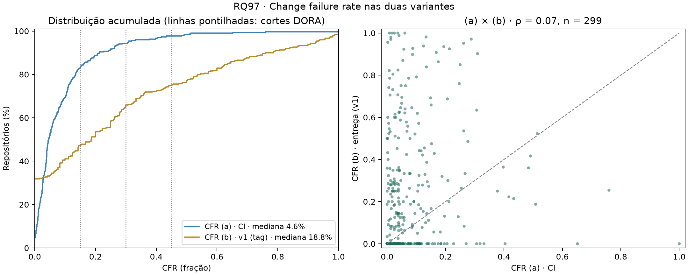
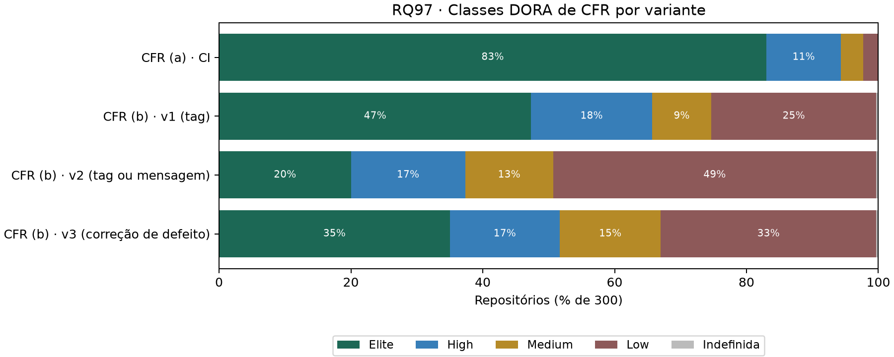

# RQ97 — RQ03: Change Failure Rate nas duas variantes

## Pergunta e método

Qual a taxa de falha das mudanças entregues por esses repositórios? Análise local de **300 repositórios**, janela UTC inclusiva 2025-10-01 a 2026-09-30, **ainda não confirmada pelo professor na configuração**.

- **(a) Proxy de CI:** falhas / (falhas + sucessos) dos workflow runs de `push` no default branch criados na janela, todos os workflows juntos. `success` é sucesso; `failure`, `timed_out` e `startup_failure` são falha; `cancelled`, `skipped`, `neutral`, `action_required`, `stale` e vazio são ignorados. Mede **falha de pipeline**.
- **(b) Proxy de entrega:** uma release (publicada, não draft, não pré-release) falha se for seguida, em até 7 dias (inclusive), por uma release corretiva; CFR = releases que falharam / releases avaliadas. As releases dos últimos 7 dias da janela são **censuradas** e ficam fora do denominador. Heurística padrão do projeto: `patch_semver_v1` (só o número de *patch* mudou em relação à release anterior), **sem validação manual concluída**.

Cada repositório tem o mesmo peso; quartis por interpolação linear. O IC de 95% é um intervalo percentil por *bootstrap* da mediana (5000 réplicas, semente 42). Classes DORA: Elite ≤ 15%, High ≤ 30%, Medium ≤ 45%, Low > 45%.

## Cobertura e auditoria

- Runs lidos de `push` no default branch: **948146**; válidos (sucesso ou falha): **861659**; ignorados: **86487** (9.1% dos lidos; mediana por repositório 2.3%).
- A recontagem do CFR (a) a partir de `workflow_runs.csv.gz` **reproduz** falhas, sucessos e CFR de `metricas_repositorios.csv` em todos os repositórios.
- O CFR (b) da v1 foi calculado de forma vetorizada e **conferido** com `metricas.variantes.cfr_entrega` em todos os repositórios (avaliadas, falhas e censuradas); também coincide com o CFR (b) usado na RQ96.
- Releases na janela: **18206**; avaliadas no CFR (b): **17714**; censuradas pela regra dos 7 dias: **492**.
- 1 repositório sem release avaliável (todas censuradas ou sem avaliação): `Alishahryar1/free-claude-code`. Ele fica com CFR (b) indefinido (n = 299), não zero.

## Resultados

Frações em percentual; n = repositórios com a variante definida.

| Variante | n | Mediana | IC 95% da mediana | Q1–Q3 | IQR | P10–P90 | Mín.–máx. | Média | Classe da mediana |
|---|---:|---:|---:|---:|---:|---:|---:|---:|---|
| CFR (a), proxy de CI | 300 | 4.6% | 4.0%–5.6% | 2.3%–11.1% | 8.8% | 0.7%–21.2% | 0.0%–100.0% | 9.1% | Elite |
| CFR (b), proxy de entrega (v1) | 299 | 18.8% | 13.3%–23.5% | 0.0%–44.7% | 44.7% | 0.0%–76.5% | 0.0%–100.0% | 27.4% | High |
| CFR (b) com patch_ou_mensagem_v2 | 299 | 43.5% | 37.5%–52.0% | 20.0%–73.1% | 53.1% | 5.6%–92.8% | 0.0%–100.0% | 46.7% | Medium |
| CFR (b) com correcao_de_defeito_v3 | 299 | 27.3% | 22.2%–33.3% | 10.0%–57.0% | 47.0% | 0.0%–80.9% | 0.0%–100.0% | 34.6% | High |

- **CFR (a):** mediana **4.6%** (Q1–Q3 2.3%–11.1%), classe **Elite**. Somando todos os runs da amostra, o CFR é 9.2% (79465 falhas em 861659 runs), pois os repositórios com muitos runs falham mais. 14 repositórios não têm nenhuma falha e 7 passam de 45%.
- **CFR (b), v1:** mediana **18.8%** (Q1–Q3 0.0%–44.7%), classe **High**, com dispersão muito maior que a do (a): IQR de 44.7% contra 8.8%. Somando todas as releases avaliadas, o CFR (b) é 38.2% (6773 de 17714).

### Classes DORA de CFR

| Variante | Elite | High | Medium | Low | Indefinida |
|---|---:|---:|---:|---:|---:|
| CFR (a) · CI | 249 (83.0%) | 34 (11.3%) | 10 (3.3%) | 7 (2.3%) | 0 |
| CFR (b) · v1 (tag) | 142 (47.3%) | 55 (18.3%) | 27 (9.0%) | 75 (25.0%) | 1 |
| CFR (b) · v2 (tag ou mensagem) | 60 (20.0%) | 52 (17.3%) | 40 (13.3%) | 147 (49.0%) | 1 |
| CFR (b) · v3 (correção de defeito) | 105 (35.0%) | 50 (16.7%) | 46 (15.3%) | 98 (32.7%) | 1 |

O CFR (a) concentra **249 repositórios em Elite** (83.0%): com mediana de 4.6%, o corte de 15% discrimina pouco. O CFR (b) espalha os repositórios pelas quatro classes, com 75 em Low.

## Comparação entre as variantes

Em **182 repositórios** o CFR (b) é maior que o (a), em **108** é menor e em **9** é igual (n = 299); a diferença mediana (b) − (a) é de 9.3 pontos percentuais. Wilcoxon pareado: W = 9355.0, p = 2.11e-16, rank-bisserial = 0.557 (positiva = (b) maior). **Correlação de Spearman entre (a) e (b): ρ = 0.065 (p = 0.259, n = 299).**

**171 repositórios (57.2%) mudam de classe** ao trocar (a) por (b): 27 melhoram e 144 pioram; 101 mudam duas classes ou mais. Kappa de Cohen ponderado (linear) = 0.022 (leve). Matriz de transição (linhas: (a); colunas: (b)):

| (a) \ (b) | Elite | High | Medium | Low |
|---|---:|---:|---:|---:|
| **Elite** | 122 | 46 | 21 | 59 |
| **High** | 14 | 4 | 3 | 13 |
| **Medium** | 4 | 3 | 1 | 2 |
| **Low** | 2 | 2 | 2 | 1 |

As duas variantes quase não concordam sobre **quem** falha mais: o ρ é próximo de zero e a maioria dos repositórios muda de classe. Elas medem coisas diferentes, como previsto na H3.

### Falha de pipeline não é falha em produção

- **O que o (a) captura.** 98.6% das falhas são `failure` e 1.4% são `startup_failure` (workflow que nem chegou a iniciar; 26 repositórios têm algum), e nenhuma é `timed_out`. Em cada repositório, o workflow mais falho responde por **73.1%** das falhas na mediana (Q1–Q3 52.4%–97.4%), e a mediana de workflows com runs válidos é 4. Ou seja, o CFR (a) costuma refletir sobretudo um ou dois workflows, e não o conjunto das mudanças entregues; os dados não dizem por que eles falham.
- **O que o (a) não vê.** Um defeito que passa na CI e chega ao usuário não aparece; uma quebra corrigida no *commit* seguinte conta como falha, ainda que nunca tenha saído do `main`. Por isso o (a) é um indicador de **fragilidade do pipeline**, e sua classe Elite quase universal não implica entregas estáveis.
- **O que o (b) captura.** Releases seguidas, em até 7 dias, de uma versão de *patch*. Isso inclui correções de defeito, mas pode incluir também *patches* planejados, releases automáticas e *backports*; e o que o (b) não vê, porque a v1 só lê a tag, são correções publicadas como *minor* ou fora do SemVer.

## Limites do CFR (b)

- **Cobertura da heurística.** 7130 das 18206 releases (39.2%) têm tag fora do SemVer estrito e **nunca** são corretivas na v1. **42 repositórios** não têm nenhuma tag SemVer: o CFR (b) deles é zero **por construção**. Dos 95 repositórios com CFR (b) igual a zero, 42 estão nesse caso.
- **Releases de *patch* são frequentes.** Na mediana, 42.9% das releases de um repositório mudam só o *patch* (Q1–Q3 10.0%–76.4%). Esse percentual é alto para correções de defeito; é compatível com releases automatizadas e incrementos rotineiros de *patch*, mas os dados não permitem separar as causas.
- **Restrição aos repositórios SemVer.** Nos 222 repositórios com pelo menos 80% das releases em SemVer, a mediana do CFR (b) é **26.8%** (Q1–Q3 8.5%–57.1%; classe High), acima dos 18.8% da amostra inteira; os repositórios fora do SemVer, onde a v1 não enxerga correções, puxam a mediana da amostra para baixo.
- **Denominador pequeno.** A mediana de releases avaliadas por repositório é 24 (Q1–Q3 12–58); 48 repositórios têm menos de 10, e uma única release muda o CFR em mais de 10 pontos percentuais.

## Sensibilidade à heurística de release corretiva

O CFR (b) depende de uma heurística automática que, segundo o enunciado, precisa ser validada contra a amostra-ouro (precisão, recall e F1 ≥ 0,70). **Nenhum F1 foi medido até esta análise** (o consenso da amostra-ouro, RQ88, não está no repositório); por isso a versão padrão do projeto continua a v1, e as versões v2 e v3 (RQ89) entram aqui só para medir o quanto o CFR (b) depende da escolha. Nenhuma delas tem F1 medido.

| Versão | Mediana do CFR (b) | Q1–Q3 | Mediana da proporção de releases marcadas corretivas | ρ com a v1 | Mudam de classe vs v1 | κ ponderado vs v1 |
|---|---:|---:|---:|---:|---:|---:|
| v1 (tag; padrão) | 18.8% | 0.0%–44.7% | 42.9% | — | — | — |
| patch_ou_mensagem_v2 | 43.5% | 20.0%–73.1% | 98.6% | 0.590 | 122 (40.8%) | 0.474 |
| correcao_de_defeito_v3 | 27.3% | 10.0%–57.0% | 61.3% | 0.686 | 95 (31.8%) | 0.628 |

- A v2 (patch **ou** qualquer commit com `fix`, `revert` ou `hotfix`) marca quase todas as releases como corretivas (mediana de 98.6% por repositório): releases com muitos commits quase sempre carregam algum `fix`. Em relação à v1, 122 repositórios mudam para classe pior e 0 para melhor.
- A v3 é mais seletiva, mas ainda marca 61.3% das releases na mediana: um único `revert` ou `hotfix` em qualquer commit do intervalo basta, e em releases grandes isso é comum.
- As três versões ordenam os repositórios de forma só parcialmente parecida (ρ entre 0.59 e 0.69 com a v1), mas o **nível** do CFR (b) muda muito: a mediana vai de 18.8% (v1) a 43.5% (v2). Sem a validação, o valor absoluto do CFR (b) não deve ser tomado como taxa de falha em produção.
- As mensagens vêm de `commits_releases.csv.gz`, que não é versionado (acima de 100 MB); o SHA-256 do arquivo usado está em `resumo.json`. Para 18147 releases o `compare` estava completo e as mensagens foram usadas; nas demais, só a tag vale.

## Confronto com H3

A H3 previa CFR de CI (a) com mediana entre 10% e 25% (Elite/High); CFR de entrega (b) menor, entre 5% e 15%, porém mais variável; e correlação fraca entre (a) e (b) (|ρ| < 0,3).

- **(a) entre 10% e 25%:** **não confirmada**. A mediana é 4.6%, abaixo da faixa; a classe é Elite, como previsto, mas por uma margem maior que a esperada.
- **(b) entre 5% e 15% e menor que o (a):** **não confirmada**. A mediana da v1 é 18.8%, acima da faixa e acima da mediana do (a). A previsão de que a entrega falharia menos que o pipeline não se sustenta com o proxy atual.
- **(b) mais variável:** **confirmada** (IQR de 44.7% contra 8.8%).
- **Correlação fraca entre (a) e (b):** **confirmada** (ρ = 0.065, p = 0.259).

**H3 parcialmente confirmada** (2 de 4 previsões). A previsão de que os dois proxies medem fenômenos diferentes se confirma; os níveis previstos, não. O nível do (b) depende da heurística, ainda sem validação, e o do (a) depende do corte DORA de 15%.

## Limitações

Release é proxy de deploy; falha de CI é proxy de falha. A heurística do CFR (b) não foi validada (F1 pendente) e só olha a tag na v1; a janela ainda não foi confirmada pelo professor; os cortes DORA vêm de questionários com empresas e não foram calibrados para *open source*; as classes tratam Elite…Low como equidistantes no κ ponderado; a amostra é de repositórios populares com GitHub Actions, não probabilística. IC por *bootstrap* da mediana não é intervalo populacional.

## Reprodução e dicionário das saídas

`python codigo-fonte/analise/rq97_cfr.py` (opções `--entrada`, `--saida`, `--commits` e `--sem-commits`). Não exige token nem rede.

- repositorios.csv: nome_completo, linguagem, estrelas, idade_anos, contribuidores_total, frequencia_deploy_semana (releases/semana), releases_janela (contagem); cfr_ci (fração) e runs_validos, runs_falha, runs_sucesso, runs_push_branch, runs_ignorados (contagens de runs); falhas_failure, falhas_startup_failure, falhas_timed_out (contagens); workflows_com_falha e workflows_com_runs (contagens); participacao_workflow_mais_falho (fração das falhas do repositório no workflow que mais falha); cfr_entrega (fração, v1), releases_avaliadas_cfr, releases_falha_cfr, releases_censuradas_cfr (contagens), releases_corretivas, releases_na_janela, releases_sem_semver (contagens); proporcao_semver e proporcao_corretivas (fração das releases da janela); classe_cfr_a e classe_cfr_b; e, quando há mensagens de commit, cfr_entrega_<heurística>, corretivas_<heurística> e classe_cfr_<heurística>.
- estatisticas.csv: variante, rotulo, n e indefinidos (contagens); mediana, q1, q3, iqr, p10, p90, minimo, maximo, media (fração); ic95_mediana_inf e _sup (fração); classe_da_mediana.
- classes_dora.csv: variante, classe (inclui Indefinida), repositorios (contagem) e percentual_definidos.
- transicoes_classes.csv: matriz classe do (a) × classe do (b), em repositórios.
- sensibilidade_heuristica.csv: por versão v2 e v3, n, spearman_com_v1, proporcao_corretivas_mediana, mudam, proporcao_mudam, melhoram, pioram e kappa_linear em relação à v1.
- resumo.json: estatísticas, classes, comparação, composição das falhas de CI, estrutura do CFR (b), sensibilidade e SHA-256 das entradas. Campos sem estimativa são null.
- cfr_variantes.png/.svg e cfr_classes.png/.svg.

Referências locais: metricas/ci.py; metricas/variantes.py; metricas/corretiva.py; metricas/dora.py; RQ95 e RQ96 em entregas/laboratorio-03/sprint-03; H3 em entregas/laboratorio-03/artigo/introducao.tex.
