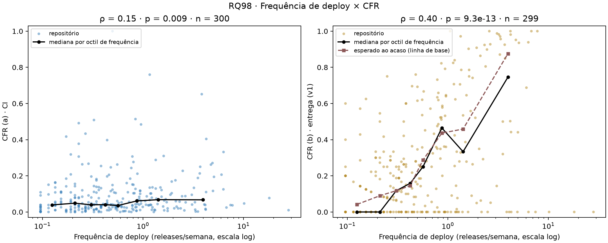
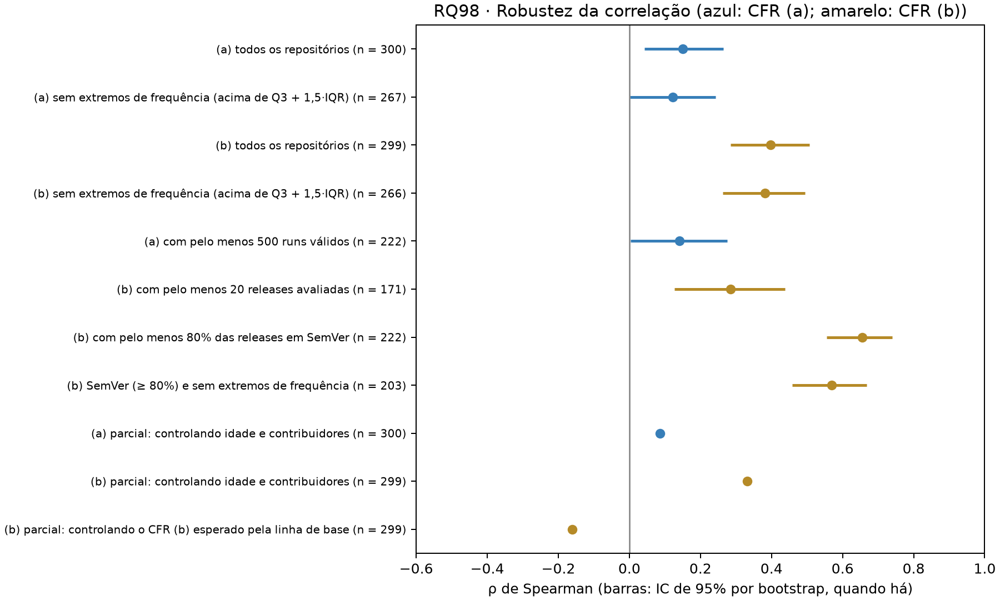

# RQ98 — RQ05: Correlação entre Deployment Frequency e Change Failure Rate

## Pergunta e método

Repositórios com maior frequência de deploy apresentam maior ou menor taxa de falha? Análise local de **300 repositórios**, janela UTC inclusiva 2025-10-01 a 2026-09-30, **ainda não confirmada pelo professor na configuração**.

- **Frequência de deploy** (RQ01): releases publicadas (não draft, não pré-release) na janela / semanas da janela.
- **CFR (a)** de CI e **CFR (b)** de entrega (heurística padrão `patch_semver_v1`, **sem validação manual concluída**), como na RQ97. O CFR (b) é recalculado aqui e conferido com `metricas.variantes.cfr_entrega`; o CFR (a) vem da coleta e a classe é reclassificada.
- **Correlação de Spearman** (ρ, p-valor, n) entre a frequência e cada variante, calculada **separadamente**; só entram os repositórios com as duas medidas (299 no (b), porque 1 repositório não tem release avaliável). IC de 95% por *bootstrap* de pares (2000 réplicas, semente 42); correção de Holm para os dois testes principais. Convenção para |ρ|: < 0,1 desprezível, < 0,3 fraca, < 0,5 moderada, ≥ 0,5 forte.

## Resultados

| Variante | n | ρ de Spearman | p | p (Holm) | IC 95% do ρ | Leitura |
|---|---:|---:|---:|---:|---|---|
| CFR (a) · CI | 300 | 0.150 | 0.009 | 0.009 | 0.04 a 0.27 | fraca positiva |
| CFR (b) · entrega (v1) | 299 | 0.398 | 9.3e-13 | 1.9e-12 | 0.29 a 0.51 | moderada positiva |

A figura usa escala logarítmica na frequência, que varia de 0.096 a 28.2 releases/semana (mediana 0.479). A linha preta é a mediana do CFR em oito faixas de frequência com o mesmo número de repositórios.

- **CFR (a):** ρ = **0.150** (p = 0.009; Holm 0.009), correlação **fraca positiva**.
- **CFR (b):** ρ = **0.398** (p = 9.3e-13), correlação **moderada positiva**: os repositórios que mais publicam releases são os que mais têm uma release corretiva logo em seguida.

### Por faixas de frequência (quartis)

| Faixa | n | Frequência (releases/semana) | Mediana CFR (a) | Mediana CFR (b) | CFR (b) esperado ao acaso | Releases com sucessora em 7 dias |
|---|---:|---|---:|---:|---:|---:|
| Q1 | 78 | 0.096–0.230 | 4.1% | 0.0% | 5.9% | 18% |
| Q2 | 75 | 0.249–0.479 | 4.0% | 13.0% | 12.1% | 28% |
| Q3 | 72 | 0.499–1.151 | 4.4% | 32.4% | 34.7% | 62% |
| Q4 | 75 | 1.170–28.173 | 6.8% | 44.2% | 66.9% | 91% |

### As classes DORA caminham juntas?

Proporção de repositórios com CFR **Elite ou High** (≤ 30%) entre os de frequência **alta** (Elite ou High, ≥ 1 release/semana; 80 repositórios) e entre os de frequência baixa (Medium ou Low):

| CFR | n | Frequência alta | Frequência baixa | Razão de chances | Fisher (p) |
|---|---:|---|---|---:|---:|
| CFR (a) · CI | 300 | 75 de 80 (94%) | 208 de 220 (95%) | 0.87 | 0.781 |
| CFR (b) · entrega (v1) | 299 | 32 de 80 (40%) | 165 de 219 (75%) | 0.22 | 3.8e-08 |

## Por que o CFR (b) sobe com a frequência: acoplamento mecânico

O CFR (b) conta uma falha quando **qualquer** release corretiva sai em até 7 dias depois. Quanto mais frequentes as releases, mais provável que **alguma** release caia nessa janela, e mais provável que seja um *patch*, mesmo que os *patches* estejam espalhados ao acaso. Isso cria uma relação aritmética entre a frequência e o CFR (b) que **não depende de o repositório ser mais ou menos estável**.

- **Oportunidade de falha.** A fração das releases avaliadas com alguma sucessora em até 7 dias tem ρ = **0.83** com a frequência (mediana de 18% na faixa Q1 e 91% na Q4). Já a proporção de releases que são *patch* quase não varia com a frequência (ρ = -0.02).
- **Linha de base.** Embaralhando, em cada repositório, quais releases são corretivas (1000 permutações, semente 42; datas e número de corretivas preservados), o CFR (b) esperado ao acaso tem ρ = **0.591** com a frequência, maior que o observado (0.398). A mediana do esperado é 20.6%, contra 18.8% observada; o CFR (b) observado fica abaixo do esperado em 128 repositórios e acima em 121.
- **Faixa a faixa.** Na faixa de maior frequência, a mediana observada é 44.2% e a esperada ao acaso, 66.9%; na de menor frequência, 0.0% e 5.9%.
- **Correlação parcial.** Controlando pelo CFR (b) esperado ao acaso, o ρ entre frequência e CFR (b) é **-0.161** (p = 0.005, n = 299): negativo, e bem menor em módulo que o ρ bruto.

A leitura é cautelosa: a linha de base supõe que as corretivas poderiam cair em qualquer release do repositório; ela absorve o efeito aritmético, mas não prova que a relação restante seja causal, e perto de CFR = 0 ou 1 há efeito de piso e teto. O que ela mostra é que o ρ positivo do CFR (b) **não** é evidência de um *trade-off* entre velocidade e estabilidade.

## Robustez

| Subconjunto | n | ρ | p | IC 95% |
|---|---:|---:|---:|---|
| (a) todos os repositórios | 300 | 0.150 | 0.009 | 0.04 a 0.27 |
| (a) sem extremos de frequência (acima de Q3 + 1,5·IQR) | 267 | 0.122 | 0.047 | 0.00 a 0.24 |
| (b) todos os repositórios | 299 | 0.398 | 9.3e-13 | 0.29 a 0.51 |
| (b) sem extremos de frequência (acima de Q3 + 1,5·IQR) | 266 | 0.382 | 1.2e-10 | 0.26 a 0.49 |
| (a) com pelo menos 500 runs válidos | 222 | 0.140 | 0.037 | 0.00 a 0.28 |
| (b) com pelo menos 20 releases avaliadas | 171 | 0.285 | 1.5e-04 | 0.13 a 0.44 |
| (b) com pelo menos 80% das releases em SemVer | 222 | 0.655 | 1.2e-28 | 0.56 a 0.74 |
| (b) SemVer (≥ 80%) e sem extremos de frequência | 203 | 0.568 | 9.0e-19 | 0.46 a 0.67 |
| (a) parcial: controlando idade e contribuidores | 300 | 0.087 | 0.135 | — |
| (b) parcial: controlando idade e contribuidores | 299 | 0.332 | 4.5e-09 | — |
| (b) parcial: controlando o CFR (b) esperado pela linha de base | 299 | -0.161 | 0.005 | — |

- **Extremos de frequência.** Há 33 repositórios acima de Q3 + 1,5·IQR = 2.54 releases/semana; retirá-los não muda a conclusão.
- **Cobertura SemVer.** Restringindo o CFR (b) aos repositórios com pelo menos 80% das releases em SemVer, onde a heurística enxerga os *patches*, o ρ sobe para 0.655 (n = 222); nesse subconjunto o esperado ao acaso tem ρ = 0.781, de novo acima do observado. O acoplamento mecânico é ainda mais forte onde o proxy funciona melhor.
- **Fatores de confusão.** Controlando idade e contribuidores, o ρ é 0.087 para o CFR (a) (p = 0.135) e 0.332 para o CFR (b) (p = 4.5e-09).

## Confronto com H5

A H5 previa ausência de *trade-off*: ρ próximo de zero ou levemente negativo entre frequência e CFR (b), em linha com o DORA, e próximo de zero para o CFR (a).

- **CFR (b) próximo de zero ou levemente negativo:** **não confirmada**. O ρ bruto é 0.398 (moderada positiva). A previsão falha no número, mas o mecanismo acima mostra que o resultado bruto é em grande parte aritmético; depois de descontar a linha de base, o ρ parcial é -0.161.
- **CFR (a) próximo de zero:** **parcialmente confirmada**. ρ = 0.150 (fraca positiva; p = 0.009): estatisticamente distinguível de zero com n = 300, mas de magnitude pequena e, controlando idade e contribuidores, 0.087 (p = 0.135).

**H5 parcialmente confirmada**: vale, de forma fraca, para o CFR (a); não vale no valor bruto do CFR (b). Sobre a afirmação do DORA, os dados *open source* **não a confirmam nem a contradizem de forma conclusiva**: no CFR (a), a relação é fraca; no CFR (b), a relação positiva observada é compatível com o efeito aritmético da frequência. Em termos de classes, 94% dos repositórios de frequência alta têm CFR (a) Elite ou High, contra 95% nos de frequência baixa (Fisher p = 0.781); no CFR (b), 40% contra 75% (Fisher p = 3.8e-08). Correlação não implica causalidade: tamanho da equipe, maturidade e automação de releases podem afetar as duas medidas.

## Limitações

Release é proxy de deploy e CFR é proxy de falha; o CFR (b) depende de uma heurística **sem F1 medido** e, na v1, só lê a tag (ver RQ97). A correlação é calculada sobre as medianas/taxas por repositório, uma por projeto, sem considerar que repositórios muito ativos têm muito mais observações. A linha de base é um diagnóstico, não uma estimativa causal: supõe que as corretivas são permutáveis entre as releases de um repositório. O ρ bruto do (b) não deve ser lido como evidência de *trade-off*. A janela ainda não foi confirmada pelo professor; a amostra de repositórios populares com GitHub Actions não é probabilística; IC por *bootstrap* não é intervalo populacional.

## Reprodução e dicionário das saídas

`python codigo-fonte/analise/rq98_correlacao_df_cfr.py` (opções `--entrada` e `--saida`). Não exige token, rede nem `commits_releases.csv.gz`.

- repositorios.csv: nome_completo, linguagem; frequencia_deploy_semana (releases/semana); cfr_ci e cfr_entrega (fração); classe_frequencia, classe_cfr_a, classe_cfr_b; releases_avaliadas_cfr, releases_corretivas, releases_na_janela, releases_sem_semver (contagens); proporcao_semver (fração das releases da janela); cfr_nulo e cfr_nulo_desvio (CFR (b) esperado ao acaso e desvio, fração); oportunidade_7d (fração das releases avaliadas com sucessora em até 7 dias); cfr_b_menos_nulo (pontos de fração); runs_validos, idade_anos e contribuidores_total.
- correlacoes.csv: variante, rotulo, n, rho, p, ic95_inf, ic95_sup, interpretacao e p_holm.
- robustez.csv: variante, subconjunto, n, rho, p, ic95_inf, ic95_sup e interpretacao (as linhas "parcial" não têm IC).
- faixas_frequencia.csv: quartis de frequência com n, frequencia_min/max (releases/semana), medianas de CFR (a), CFR (b), CFR (b) esperado e oportunidade_7d, e contagens de Elite/High.
- resumo.json: correlações, linha de base, robustez, cruzamento das classes e SHA-256 das entradas. Campos sem estimativa são null.
- dispersao_df_cfr.png/.svg e robustez_rho.png/.svg.

Referências locais: RQ91, RQ95, RQ96 e RQ97 em entregas/laboratorio-03/sprint-03; metricas/variantes.py; H5 em entregas/laboratorio-03/artigo/introducao.tex.
